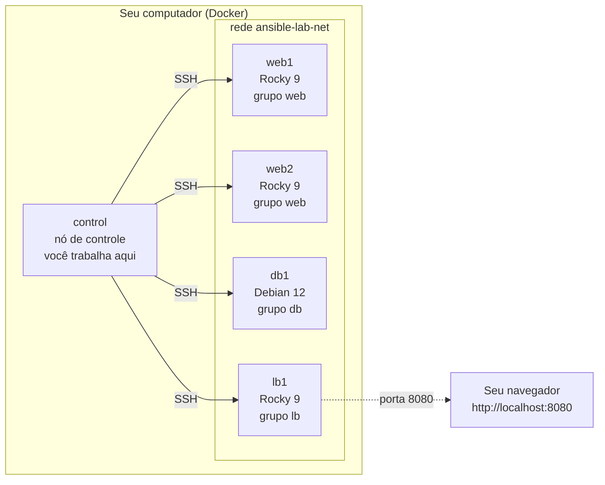

# Laboratório Ansible — TRE-SE

Laboratório prático do treinamento de Ansible para consultores. Tudo roda em Docker, na sua máquina:
um **nó de controle** (onde você trabalha) e **quatro nós gerenciados** (onde o Ansible age).

- **Instrutor:** Yelken Gonzales
- **Formato de cada encontro:** teoria em slides → exercício de arquitetura no papel → LAB
- **Objetivo:** você sair capaz de **entender, arquitetar e construir** automação — não apenas copiar playbook.

## Topologia



| Contêiner | Papel | Sistema | Grupos no inventário (você cria no desafio 01) |
|---|---|---|---|
| `control` | Nó de controle | Debian 13 + Python 3.13 + ansible-core 2.21 | — |
| `web1`, `web2` | Nós gerenciados | Rocky Linux 9 | `web` |
| `db1` | Nó gerenciado | Debian 12 | `db` |
| `lb1` | Nó gerenciado | Rocky Linux 9 | `lb` |

Os dois sistemas diferentes são propositais: eles têm gerenciadores de pacote e nomes de serviço diferentes.

## Pré-requisitos

- Docker com **Compose v2** (Docker Desktop no Windows/macOS, ou Docker Engine no Linux/WSL2).
- ~4 GB de memória liberados para o Docker e ~5 GB de disco.
- Windows: Windows 10/11 com WSL2. macOS: Intel ou Apple Silicon. Linux: qualquer distribuição recente com cgroup v2.
- Um editor de texto na sua máquina (VS Code, Cursor, Notepad++...). Você edita os arquivos **no seu editor** e roda os comandos **no nó de controle**.

Instalação passo a passo e solução de problemas: [`docs/00-preparacao.md`](docs/00-preparacao.md).

## Início rápido

Abra um terminal **na pasta deste repositório**.

| Windows (PowerShell) | Linux / macOS / WSL2 |
|---|---|
| `.\lab.ps1 doctor` | `./lab doctor` |
| `.\lab.ps1 up` | `./lab up` |
| `.\lab.ps1 shell` | `./lab shell` |

> No restante deste documento usamos `lab` como abreviação. No PowerShell, leia `.\lab.ps1`.
> Se o PowerShell bloquear o script: `powershell -ExecutionPolicy Bypass -File .\lab.ps1 up`.

1. **`lab doctor`** confere Docker, Compose v2, memória, arquitetura e portas. Resolva o que ele marcar com ✘.
2. **`lab up`** constrói as imagens (só na primeira vez: leva alguns minutos e precisa de internet), gera as chaves SSH, sobe os 5 contêineres e espera o SSH responder.
3. **`lab shell`** abre um terminal **dentro do nó de controle**, na pasta `/lab`. O prompt mostra `[control]`.

Pronto: dentro do nó de controle, `ansible` e `ansible-playbook` já estão instalados. Você escreve o inventário no desafio 01.

## Fluxo de um desafio

Cada desafio fica em `desafios/NN-nome/` e segue sempre o mesmo caminho:

1. **Prepare o cenário:** `lab start NN` recria os nós e deixa tudo no estado inicial do desafio. Assim, um desafio nunca depende de você ter concluído o anterior.
2. **Leia o `README.md` do desafio:** teoria curta, cenário, missão e critérios de aceite.
3. **Desenhe antes de digitar:** preencha o `DESENHO.md` (as cinco perguntas do [`docs/metodo.md`](docs/metodo.md)) **antes** de escrever qualquer YAML.
4. **Construa:** edite os arquivos no seu editor (pasta `desafios/`) e execute no nó de controle (`lab shell`, dentro de `/lab/NN-nome`).
5. **Verifique:** `lab verify NN` mostra, critério por critério, o que está aprovado ou reprovado. As mensagens dizem **o que** está diferente do esperado — nunca **como** corrigir.
6. **Travou?** Abra as dicas do desafio, uma de cada vez (da mais conceitual à mais direta), ou use `lab hint NN`.
7. **Refaça do zero se quiser:** `lab reset` devolve os nós ao estado inicial sem apagar os seus arquivos. Um bom playbook roda do zero e chega ao mesmo resultado.

A **missão essencial** de cada desafio cabe em 10 a 15 minutos. A **extensão opcional** é para quem termina cedo ou quer continuar em casa.

## Comandos do `lab`

| Comando | O que faz |
|---|---|
| `lab up` | Constrói se preciso, gera as chaves, sobe os 5 contêineres e espera o SSH responder |
| `lab shell` | Abre um terminal no nó de controle, em `/lab` |
| `lab verify NN` | Roda o verificador do desafio NN (lista de itens aprovados/reprovados) |
| `lab reset` | Recria os nós gerenciados no estado inicial (**não** apaga o seu trabalho) |
| `lab start NN` | `reset` + prepara o estado inicial exigido pelo desafio NN |
| `lab hint NN` | Mostra a próxima dica do desafio NN |
| `lab status` | Mostra os contêineres e se o Ansible alcança cada nó |
| `lab down` | Para e remove os contêineres (`lab down -v` remove também as chaves SSH) |
| `lab build` | Reconstrói as imagens |
| `lab doctor` | Confere Docker, Compose v2, memória, arquitetura e portas |
| `lab save` / `lab load` | Salva/carrega as imagens em um arquivo (uso sem internet) |

Seus arquivos em `desafios/` **nunca** são apagados por nenhum desses comandos.

## Como usar IA neste laboratório

Você pode (e deve) usar um assistente de IA — como consultor, a IA fará parte do seu dia a dia. Mas aqui ele atua como **tutor**, não como autor: explica conceitos, interpreta mensagens de erro, aponta onde olhar na documentação e responde com perguntas que levam ao próximo passo. As regras estão em `AGENTS.md` e em `.cursor/rules/tutor.mdc`.

**Por quê?** Quem não sabe desenhar a solução não consegue revisar a solução que recebeu pronta. Em produção, um playbook gerado por IA e aceito sem entendimento é um risco: ele pode rodar com sucesso e ainda assim estar errado (não idempotente, com segredo exposto, atingindo o grupo errado). O que torna você um consultor é a capacidade de **desenhar** o estado desejado, **prever** o que o Ansible vai fazer e **julgar** o que foi gerado. É exatamente isso que o `DESENHO.md` e os verificadores treinam.

Uma boa pergunta para a IA: *"o que esta mensagem de erro significa?"* ou *"qual a diferença entre `vars` e `defaults`?"*.
Uma pergunta que ela vai recusar com gentileza: *"escreve o playbook do desafio 05"*.

## Estrutura do repositório

```
├── lab, lab.ps1           comando do laboratório (Linux/macOS/WSL2 e Windows)
├── desafios/              ÚNICA pasta montada em /lab: é onde você trabalha
├── docs/                  preparação do ambiente, método das cinco perguntas, cola de comandos
├── docker/                imagens e compose do laboratório (você não precisa mexer aqui)
├── AGENTS.md              regras para assistentes de IA (tutor)
└── .cursor/rules/         as mesmas regras no formato do Cursor
```

## Problemas?

Rode `lab doctor` primeiro. Depois consulte a seção *Solução de problemas* em [`docs/00-preparacao.md`](docs/00-preparacao.md).
